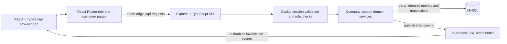
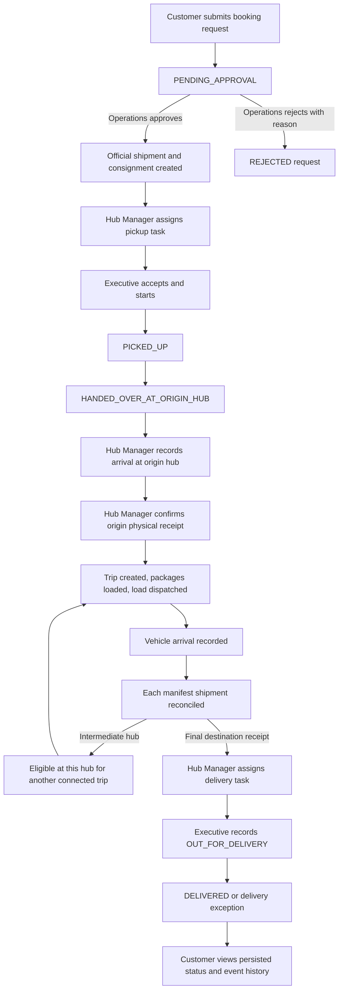
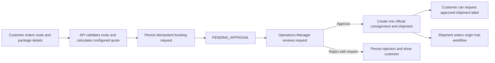
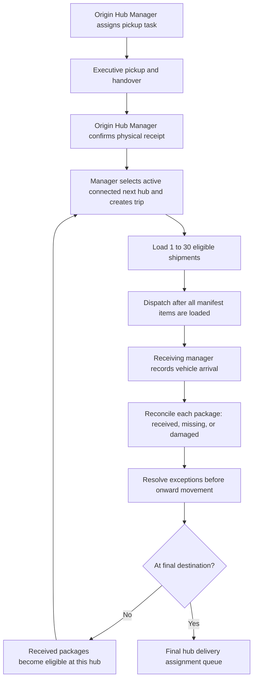
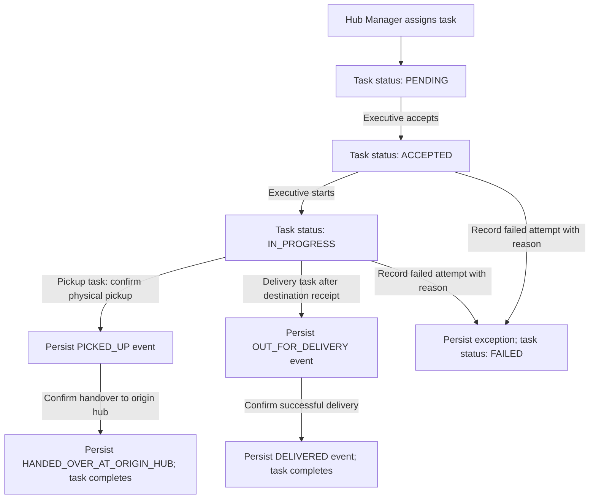
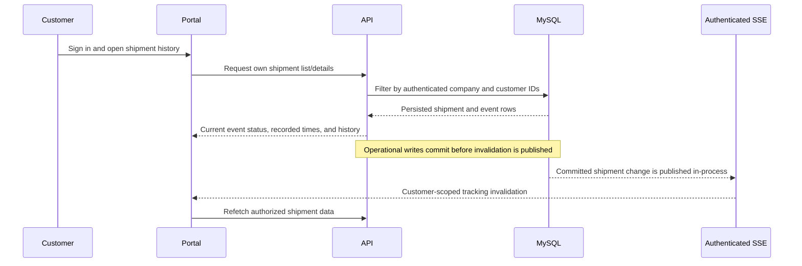

# LOGIX AI

### AI-Powered Logistics Management & Shipment Tracking Platform

Logix AI is a multi-tenant courier operations platform for coordinating shipment approvals, hub work, executive tasks, transport trips, customer bookings, and shipment visibility. The current application uses **React, TypeScript, Express, and MySQL**. The product name includes “AI,” but predictive or generative AI services are not currently connected.

[](https://react.dev/)
[](https://www.typescriptlang.org/)
[](https://nodejs.org/)
[](https://www.mysql.com/)

> A current implementation guide for developers, evaluators, and project reviewers. Feature status below reflects the code in this repository; configured databases and external services may have separate deployment state.

## Contents

- [Project overview](#project-overview)
- [Objectives](#project-objectives)
- [Feature status](#feature-status)
- [Technology stack](#technology-stack)
- [Architecture](#system-architecture)
- [Roles and access](#roles-and-access)
- [Shipment lifecycle](#shipment-lifecycle)
- [Tracking and real-time updates](#tracking-and-real-time-updates)
- [Security model](#security-model)
- [Analytics and reporting](#analytics-and-reporting)
- [Database and migrations](#database-and-migrations)
- [Repository structure](#repository-structure)
- [Local setup](#local-setup)
- [Tests and checks](#tests-and-checks)
- [Screenshots and assets](#screenshots-and-assets)
- [Known limitations](#known-limitations)
- [Future scope](#future-scope)
- [Development notes](#development-notes)
- [Project information](#project-information)

## Project overview

Courier operations involve customers, booking review, pickup teams, hubs, transport legs, and delivery. When these activities are tracked in separate tools or through manual updates, it is difficult to determine who owns the next action and which shipment events have actually occurred.

Logix AI brings these workflows into one web application. Employees work in role-specific dashboards, while customers can register, book and follow shipments. The initial customer entry flow offers DTDC; the Delhivery card is shown as coming soon. Backend records are company-scoped, and operational hub access is checked against each employee’s active hub assignments.

The system is designed to support historical shipment records as well as new operational work. Historical outcome fields are kept distinct from the event timeline: an outcome in imported data is not treated as proof that a current operational event occurred.

## Project objectives

- Centralize shipment records, booking review, and operational queues.
- Give each role only its authorized company and hub data.
- Make ownership of pickup, hub receipt, transport, and delivery actions clear.
- Let customers book shipments and view their own recorded shipment history.
- Present historical database measures through dashboards, charts, and route maps.
- Keep the data model extensible for future forecasting and assistance services.

## Feature status

| Area | Current implementation | Status |
|---|---|---|
| Employee workspaces | Company Admin, Operations Manager, Hub Manager, Logistics Executive | Implemented |
| Customer portal | Registration, sign-in, booking requests, history, details, and labels | Implemented; requires customer schema and company configuration |
| Booking review | Operations Manager can approve or reject pending requests; approval creates the official consignment | Implemented |
| Hub and executive workflow | Hub queues, assigned pickup/delivery tasks, lifecycle actions, and exceptions | Implemented |
| Transport | Company-route-based trips, multi-hop movement, manifests, arrival, per-shipment reconciliation, and load history | Implemented; transport tables are in migration 005 |
| QR | Shipment QR creation, browser camera decoding, and assignment authorization before executive actions | Implemented; scanning alone does not perform an action |
| Shipping prices | Company-configurable route/service rate rules and server-side quote calculation | Implemented; rates must be configured for a quote |
| Payments | Payment terms and persisted collection records, plus an explicitly simulated demo UPI flow | Partial/demo; no payment gateway is connected |
| OTP | Twilio Verify adapter and configuration exist, but customer HTTP registration/login does not invoke an OTP flow | Not connected to customer flow |
| Live updates | Authenticated SSE invalidations published after commit with company and role/customer scoping | Implemented in-process; not a courier feed or cross-instance event service |
| Power BI | Company Admin setup/status screen | Not connected; no embedded report or token service is configured |
| AI predictions or assistant | UI explains that providers/models are not configured | Not implemented |

## Technology stack

| Layer | Technologies used |
|---|---|
| Frontend | React 19, TypeScript 5.9, Vite, React Router |
| API | Node.js, Express 4, TypeScript, Zod validation |
| Database | MySQL through `mysql2` promise pools |
| Authentication | Argon2id password hashing, signed JWTs in HTTP-only cookies |
| Security middleware | Helmet, cookie-parser, express-rate-limit |
| Charts | Plotly.js and react-plotly.js |
| Maps | Local India state geometry (GeoJSON/SVG) and recorded hub coordinates |
| QR and labels | ZXing browser QR reader, `qrcode`, and jsPDF |
| Tests | Node.js test runner with `tsx`; React Testing Library for frontend tests |
| Build | TypeScript compiler and Vite production bundler |

Dependency versions are maintained in the root and workspace `package.json` files and lockfile.

## System architecture



The Vite development server proxies `/api` to the backend (default target `http://127.0.0.1:4000`). The frontend does not choose its own employee role, company, or authorized hub scope. The API reloads authenticated identity from the database and applies the appropriate access checks to each request.

### Main API groups

All routes below are served by the Express API. The backend validates the session and role on protected routes; route names alone do not grant access.

| API prefix | Purpose |
|---|---|
| `/api/auth/*` | Employee login, logout, and current session |
| `/api/company-admin/*` | Company dashboard, records, employee/hub management, and shipping pricing settings |
| `/api/operations/*` | Operations workspace, assigned-hub shipment views, booking approval/rejection, and event reads |
| `/api/hub-manager/*` | Assigned-hub workspace, shipment events/actions, executive assignment, and transport trips/manifests |
| `/api/logistics-executive/*` | Assigned tasks, assignment history, task actions, and authorized collections |
| `/api/customer/*` | Customer config/authentication, quotes, bookings, history, shipment details/labels, and customer SSE |
| `/api/health` | Database connectivity check (`SELECT 1`) |

## Roles and access

The employee role set in code is `COMPANY_ADMIN`, `OPERATIONS_MANAGER`, `HUB_MANAGER`, and `LOGISTICS_EXECUTIVE`. Database role `ADMIN` is mapped to Company Admin. There is no Super Admin role or dashboard in this implementation.

| Role | Workspace and actions | Data boundary |
|---|---|---|
| **Company Admin** | Company overview and historical analytics; employee creation and management; hub assignments; company-scoped shipping rate/payment settings; shipment and customer record lookup | Authenticated company. Shipment operations are read-only in this workspace. |
| **Operations Manager** | Assigned-hub operational overview and shipment review; pending booking approval or rejection; reports and shipment/event inspection | Company plus active hubs assigned through `employee_hubs`. Shipment actions such as pickup and delivery are not enabled here. |
| **Hub Manager** | Assigned-hub inbound/outbound queues; shipment receipt/dispatch steps; eligible executive task assignment; transport trips, manifests, arrival, and package reconciliation | Only active assigned hubs in the authenticated employee’s company. |
| **Logistics Executive** | Own assigned pickup/delivery tasks; accept/start work; pickup, handover, out-for-delivery, delivery/exception actions; permitted collection recording; assignment history | Only that employee’s assignments within their company and assigned hub scope. |
| **Customer** | Register/sign in; request a booking; view own booking requests, shipment history, shipment details/events, and approved labels | Authenticated customer ID and the server-configured customer company. |

Backend role middleware and company/hub/customer filters enforce these boundaries. Frontend route guards provide navigation behavior but are not the authorization layer.

## Shipment lifecycle

The application separates a booking request from an approved shipment. A customer submission is stored as `PENDING_APPROVAL`; an official consignment is created by Operations Manager approval. Hub and executive actions then append recorded events rather than fabricating earlier history.



### Booking and approval

1. The customer chooses an active route/service, enters package and sender/recipient details, and submits a booking request with an idempotency key.
2. When a matching company rate rule exists, the API calculates the quote from configured rates and supplied package measurements. Without a matching rate, the UI/API says the price is to be confirmed.
3. Operations Managers see pending requests within their company and assigned origin hub scope. They can approve or reject; rejection requires a reason.
4. Approval creates the shipment and its official consignment within a transaction. A repeated approval does not create another shipment. An approved shipment can then enter hub operations.

### Pickup and hub receipt

The Hub Manager assigns an eligible executive to pickup work. The executive accepts and starts the task, records pickup, and then records handover. Hub Manager actions separately record arrival and physical receipt. Assignment, pickup, handover, vehicle arrival, and package receipt are distinct persisted milestones.

### Hub transport and intermediate hops

Hub Transport uses active company routes to select a connected next hub that can still reach the shipment’s original final destination. A load contains 1–30 shipments and stores vehicle/driver details and a manifest. Every shipment must have a persisted receipt at the load’s origin hub. Loading all manifest items enables dispatch.

At the receiving hub, the manager records vehicle arrival first. Each shipment must then be reconciled individually as received, missing, or damaged. Missing/damaged items need an explicit resolution before onward transport. A shipment received at an intermediate hub remains in transit toward its original destination; it is not marked delivered there. Each trip and manifest entry remains as route history.

### Delivery

Once a shipment is physically received at its final destination hub, the Hub Manager can assign a delivery executive. The executive records out-for-delivery before confirming delivery or recording a delivery exception. Actions are checked against assignment and current persisted state by the backend.

### Booking and approval flow



### Hub processing and transport flow



### Logistics Executive flow



The executive does not create assignments. Hub Managers assign eligible work, and the API verifies that the logged-in executive owns the task before returning details or accepting an action.

### Customer tracking flow



## Tracking and real-time updates

Customer and employee views use actual `shipment_events` rows and their recorded timestamps. Transport records vehicle-level trip events separately from shipment-level events. Example shipment milestones used by current workflows include:

| Event | Meaning |
|---|---|
| `BOOKED` | Approved booking created the official shipment |
| `PICKED_UP` | Executive recorded package pickup |
| `HANDED_OVER_AT_ORIGIN_HUB` | Executive recorded handover |
| `ARRIVED_AT_ORIGIN_HUB` / `RECEIVED_AT_ORIGIN_HUB` | Origin-hub arrival and physical receipt are separate |
| `ASSIGNED_TO_TRANSPORT` / `LOADED_ON_TRANSPORT` | Shipment added to a transport trip and later loaded |
| `DISPATCHED` | Vehicle/trip departed the hub |
| `ARRIVED_AT_HUB` / `RECEIVED_AT_HUB` | Intermediate-hub arrival and package receipt are separate |
| `ARRIVED_AT_DESTINATION_HUB` / `RECEIVED_AT_DESTINATION_HUB` | Final-hub arrival and physical receipt are separate |
| `OUT_FOR_DELIVERY` / `DELIVERED` | Delivery began / was confirmed |
| `PICKUP_EXCEPTION`, `DELIVERY_EXCEPTION`, `TRANSPORT_MISSING_EXCEPTION`, `TRANSPORT_DAMAGED_EXCEPTION` | Persisted operational exceptions |

The customer history distinguishes a latest persisted event from a historical dataset outcome stored on the shipment. When no event timestamp exists, the UI leaves it unavailable; it does not substitute the shipment date. Route visualization uses available hub coordinates and persisted movement events; it does not infer intermediate stops from the origin and final destination.

Authenticated Server-Sent Events (SSE) notify subscribed screens after a successful transaction commits. Events are scoped by company and, where applicable, customer or assigned hub. The current event buffer is in-process and retains a bounded replay window; after an unavailable cursor the client refetches relevant data. SSE is an invalidation/reload mechanism, not a durable event store, cross-instance message broker, or external courier feed.

## Security model

- Employee and customer passwords are hashed with Argon2id; hashes are not returned by the API.
- Employee and customer sessions use separate signed JWT cookies. Cookies are HTTP-only, use strict same-site policy, and are secure in production; sessions expire after eight hours.
- Employee requests reload active employee/company data and role from MySQL. Role middleware restricts role-specific endpoints.
- Employee company scope comes from the authenticated record. Hub access is checked through active `employee_hubs` assignments and active hubs belonging to that company.
- Customer shipment reads use the authenticated customer ID and the server-configured active customer company. Request parameters do not grant access to another customer or company.
- Request bodies and query parameters are validated with Zod. Authentication routes are rate-limited.
- `CUSTOMER_PORTAL_MODE=demo` enables a historical-data first-login path that matches a unique normalized phone number and requires the exact existing customer name as the initial password, then stores an Argon2id hash. This is an unverified demo identity claim, not proof of real-world ownership. Keep it limited to an access-controlled demo/beta deployment; the default is `public`.
- A Twilio Verify adapter and environment fields exist, but no current customer route uses it. Do not assume OTP verification is active.
- Never commit `.env` files or use copied production credentials/data in local tests.

## Analytics and reporting

Company Admin dashboards provide company-scoped shipment, status, route, hub, mode, exception, and operational summaries. Customer home/network views combine the signed-in customer’s shipment summary with company-network aggregates returned for the configured company. Charts use Plotly; India map interactions use local geographic geometry and available company hub/network data.

These are database-derived historical/current snapshots, not a live courier feed. Rule-based risk views use stored statuses and due dates; they are not ML predictions. Estimated revenue is derived from recorded shipment amounts/charges and is not a payment collection or settlement total. The Power BI page currently reports its connection requirements and status; no Power BI report is embedded.

## Database and migrations

The code expects an existing application schema that includes core tables such as `companies`, `employees`, `employee_hubs`, `hubs`, `routes`, `customers`, `shipments`, and `shipment_events`. This repository does **not** contain a complete baseline DDL or production dataset. The versioned SQL files are additive extensions and are not applied automatically at application startup.

| Migration | Main changes |
|---|---|
| `001_create_logistics_task_progress.sql` | Creates progress rows for pickup and delivery task state; does not backfill historical tasks. |
| `002_customer_portal.sql` | Creates customer accounts and booking idempotency/request base tables with company/customer references. |
| `003_customer_first_login.sql` | Adds normalized customer phone storage and account fields for first-login setup; normalizes stored phone formatting. |
| `004_booking_approval_workflow.sql` | Adds booking request review, status, route, party, and rejection fields; existing consignment-backed requests are marked approved. |
| `005_transport_pricing_and_demo_payments.sql` | Adds rate/payment settings, shipment quote/payment fields, payment and collection records, transport trips, manifests, and trip events. |

Apply any missing migrations in numeric order only after confirming the target schema, MySQL compatibility, and backup/rollback plan with the database owner. MySQL DDL may commit implicitly; review the individual migration notes, especially for migrations 003–005. No migration command is wired to `npm run dev` or `npm start`.

The customer integration test is separate from the application database configuration. It requires an explicitly provisioned, empty disposable database named with the `logix_customer_test_` prefix, a compatible MySQL 8.0.4+ base schema, and dedicated `LOGIX_TEST_DB_*` variables. The runner refuses protected database names and never creates/drops the database. Full setup is documented in [backend/README.customer-testing.md](backend/README.customer-testing.md).

### Data relationships at a glance

- Employee roles and companies are read from the existing employee/company schema; employee hub memberships use `employee_hubs`.
- Migration 002 links `customer_accounts` to a company and customer; booking requests link to the account.
- Migration 005 links company rate rules and payment settings to a company; payment rows link to customer accounts and booking requests; trip manifests/events link to transport trips and companies.
- Shipment-to-event and baseline foreign-key details depend on the external base schema. A complete ER diagram is not included because the repository does not contain that baseline DDL.

## Repository structure

```text
.
├── backend/
│   ├── migrations/       # Additive MySQL migrations and deployment notes
│   ├── scripts/          # Password migration and administrative maintenance tools
│   ├── src/              # Express routes, auth, domain/query services, and tests
│   ├── .env.example      # Placeholder local configuration
│   └── package.json
├── frontend/
│   ├── public/           # Branding, favicon, and India map geometry
│   ├── src/              # Role workspaces, customer portal, shared auth, charts, tests
│   ├── package.json
│   └── vite.config.ts
├── Images/               # Existing DTDC logo asset
├── package.json          # npm workspace scripts
├── package-lock.json
└── README.md
```

Generated build output, dependency folders, local `.env` files, compiler caches, and verification screenshots are excluded by `.gitignore`.

## Local setup

### Prerequisites

- Node.js 20.19+ or 22.12+ and npm for the Vite 7 toolchain.
- MySQL 8.x. The customer integration notes require 8.0.4+; validate the exact SQL features and collations used against the intended server version before deployment.
- An authorized local development database with the base application schema. This repository does not provide the base schema or sample production data.

### Install and configure

```powershell
git clone https://github.com/Hemanth-Basireddy/logix-ai.git
cd logix-ai
npm install
Copy-Item backend/.env.example backend/.env
```

Edit `backend/.env` with local-only values. At minimum, set:

| Variable | Purpose |
|---|---|
| `NODE_ENV` | Runtime mode; use `development` locally. |
| `PORT` | API port; defaults to `4000`. |
| `JWT_SECRET` | At least 32 random characters; keep it private. |
| `DB_HOST`, `DB_PORT`, `DB_NAME`, `DB_USER`, `DB_PASSWORD` | Application MySQL connection. Defaults in the template are examples, not safe proof of the database target. |
| `CUSTOMER_PORTAL_COMPANY_ID` | Positive ID of an active company to enable customer routes. This variable is read by the server but is not listed in the current `.env.example`; add it only after verifying the intended company. |
| `CUSTOMER_PORTAL_MODE` | `public` by default. `demo` enables the historical phone/name first-login behavior; use only in an access-controlled demo/beta environment. |
| `DEMO_PAYMENTS_ENABLED` | Enables the simulated demo payment flow; keep `false` for production. |
| `COMPANY_BRANDING_JSON` | Optional JSON object keyed by company ID for a logo path/accent color. Company names still come from MySQL. |
| `CUSTOMER_OTP_TWILIO_ACCOUNT_SID`, `CUSTOMER_OTP_TWILIO_AUTH_TOKEN`, `CUSTOMER_OTP_VERIFY_SERVICE_SID`, `CUSTOMER_OTP_DEFAULT_COUNTRY_CODE` | Adapter configuration fields; customer registration/login does not currently invoke OTP verification. |
| `API_PROXY_TARGET` | Optional Vite process variable for a non-default backend proxy target. |

The example template names `logistics_db` as its illustrative database default. Before starting the app, positively identify and configure a local development database; do not point tests or experiments at a protected/shared database.

### Database preparation

The app expects the baseline tables listed above. Obtain the approved baseline schema for your application version from its owner; do not reconstruct it from production rows. Check which migrations are already applied, back up the target, review each migration, and apply only missing files in order:

```text
001_create_logistics_task_progress.sql
002_customer_portal.sql
003_customer_first_login.sql
004_booking_approval_workflow.sql
005_transport_pricing_and_demo_payments.sql
```

These files are not run by the app. Review `backend/migrations/README-005.md` and the comments at the top of each SQL file before applying them. The application will not create a customer company record, rates, or test fixtures automatically.

### Start the application

From the repository root, run both workspaces:

```powershell
npm run dev
```

The backend defaults to `http://127.0.0.1:4000`; Vite normally serves the frontend at `http://localhost:5173` and proxies `/api` to the backend. Open the URL printed by Vite. The database must be reachable and `JWT_SECRET` configured for backend startup. The API health check is `GET /api/health` and returns `{ "status": "ok" }` only after a successful database `SELECT 1`.

## Tests and checks

Run the existing commands from the repository root:

```powershell
npm test
npm run test --workspace frontend
npm run typecheck
npm run build
```

`npm test` runs the backend unit/service tests listed in `backend/package.json`. The frontend command runs its routing, customer-home, sidebar, and summary tests. Typecheck and build scripts cover both workspaces. These commands describe available checks; results depend on the environment in which they are run.

The MySQL customer integration command is intentionally separate and may apply migrations and write synthetic rows **only** to its verified disposable test database:

```powershell
npm run test:customer-integration --workspace backend
```

Configure the dedicated test variables and database exactly as documented in [backend/README.customer-testing.md](backend/README.customer-testing.md). Do not run that integration command against the normal application database.

## Screenshots and assets

The repository contains branding and map geometry assets, but no reviewed genuine application screenshots are included in the public source tree. Local verification screenshots and an illustrative dashboard mockup are excluded. This README therefore does not present mockups as screenshots of the running application.

## Known limitations

- No external DTDC/Delhivery shipment feed is connected; shipment changes come from authorized application workflows and database events.
- Delhivery is a visible “Coming Soon” option only; there is no Delhivery company integration in the app.
- The migration set extends a pre-existing schema; the complete baseline DDL and seed data are not in this repository.
- Customer routes require `CUSTOMER_PORTAL_COMPANY_ID` to resolve to an active database company. The code defaults `CUSTOMER_PORTAL_MODE` to `public`; demo-only historical phone/name claiming must not be enabled on an open public deployment.
- Customer OTP provider code is not wired into current customer endpoints. New registration currently does not perform OTP verification.
- Demo UPI is simulated and is not a bank-confirmed transaction. No online payment gateway is integrated. Shipping rate rules must be configured for a calculated quote; otherwise the price is shown as to be confirmed.
- SSE notifications use an in-process bounded event buffer. They are not durable, cross-instance, or driven by external courier events. Persistent notifications are not implemented.
- Power BI is a setup/status view; secure embedding is not configured.
- There is no trained/validated machine-learning model, predictive ETA, AI assistant provider, or AI-generated operational advice connected.
- No production deployment or CI/CD configuration is included in this repository.

## Future scope

The following are planned opportunities, not current capabilities:

- Train and validate delivery-delay and ETA models using approved historical data.
- Predict hub congestion and workload from measured operational signals.
- Add explainable early-delay alerts and operational recommendations.
- Connect approved AI assistance after tenant isolation, data access, and provider controls are defined.
- Add external courier integrations and durable event delivery when authorized interfaces are available.
- Integrate a production payment gateway and verified payment callbacks.
- Configure secure tenant-scoped Power BI embedding.

No predicted value, external status, or payment success should be implied until the corresponding service is implemented and verified.

## Development notes

- Frontend route and page code is under `frontend/src`; backend routes and domain services are under `backend/src`.
- Migrations are reviewed and applied operationally; there is no automatic migration-on-start behavior.
- Keep environment values in ignored `.env` files. `.env.example` uses placeholders and should remain free of credentials.
- Do not use production customer data in tests, screenshots, examples, or public issue reports.
- Review `backend/README.customer-testing.md` before running MySQL integration tests.

## Project information

| | |
|---|---|
| Project | Logix AI |
| Repository | [github.com/Hemanth-Basireddy/logix-ai](https://github.com/Hemanth-Basireddy/logix-ai) |
| Current phase | Role-based courier operations, customer portal, and hub transport workflows |
| Stack | React, TypeScript, Express, MySQL |
| Scope | DTDC-oriented initial implementation; other courier networks and predictive AI are future work |
